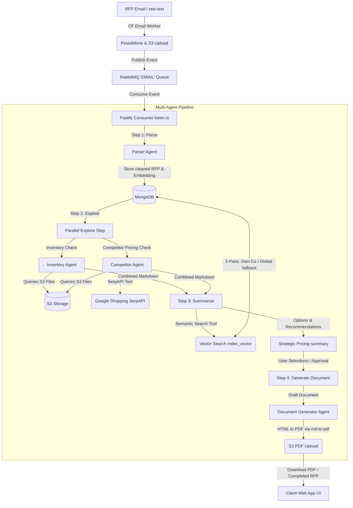

# 🛠️ BidForge AI: Multi-Agent RFP Proposal Generator

**BidForge AI** is a premium, enterprise-grade multi-agent platform designed to automate the Request for Proposal (RFP) response cycle. By utilizing specialized, collaborative AI agents, semantic vector databases, and real-time market data APIs, BidForge AI parses client requirements, runs inventory/competitor checks, generates strategic pricing suggestions, and compiles court-admissible-quality proposal PDFs—all in a structured, Human-in-the-Loop workflow.

---

## 🗺️ System Architecture

BidForge AI is built as a distributed monorepo comprising a React client dashboard, a Fastify orchestration server, a Cloudflare email-processing worker, a RabbitMQ broker, and MongoDB with Vector Search.



---

## 🤖 The Multi-Agent Pipeline

The core intelligence of BidForge AI lies in its sequential, collaborative multi-agent architecture. Each agent operates with specific tools, context buffers, and guardrails to ensure reliability.

### 📋 Phase 1: The RFP Parser Agent
*   **File Location**: [parser.ts](file:///Users/ashishsharma/codes/ignisia-hackathon/apps/backend/src/agent/parser.ts)
*   **Engine**: `google/gemini-2.5-flash-lite` via OpenRouter
*   **Goal**: Strips boilerplate, legal clauses, and pleasantries. Extracts raw technical requirements (services, quantities, budgets, delivery timelines) and flags vague areas (missing SLAs, unspecified volumes).
*   **Structured Output (Zod)**:
    ```typescript
    const rfpParserResponseFormat = z.object({
        parsedContent: z.string().describe("The parsed content of the RFP"),
        missingFields: z.array(z.string()).describe("The missing fields in the RFP"),
    });
    ```
*   **Post-processing**: The Fastify backend embeds the cleaned requirements using Hugging Face (`sentence-transformers/all-MiniLM-L6-v2`) and persists the RFP document in MongoDB with status `parsed`.

---

### 🔍 Phase 2: Parallel Exploration (Inventory + Competitor Agents)
*   **File Locations**: [inventory.ts](file:///Users/ashishsharma/codes/ignisia-hackathon/apps/backend/src/agent/inventory.ts) & [competitor.ts](file:///Users/ashishsharma/codes/ignisia-hackathon/apps/backend/src/agent/competitor.ts)
*   **Goal**: Conduct concurrent background checks to assess internal capacity and match market rates.
*   **Inventory Agent**:
    1. Fetches the company's product catalogs and inventory documents stored on S3.
    2. Uses PDF extraction to map current product lists, pricing structures, and specifications to the parsed RFP needs.
    3. Produces a detailed *Product-by-Product Fact Report*.
*   **Competitor Agent**:
    1. Reads existing competitor brochures/pricing lists from S3.
    2. Employs the `get_market_price` tool to search Google Shopping (via SerpAPI) if local rates are missing or outdated.
    3. Truncates outliers using the **Interquartile Range (IQR)** method and calculates the median, minimum, maximum, and sample size count.

---

### 📊 Phase 3: The Summariser Agent
*   **File Location**: [summariser.ts](file:///Users/ashishsharma/codes/ignisia-hackathon/apps/backend/src/agent/summariser.ts)
*   **Goal**: Formulate strategic pricing proposals based on internal costs, competitor intelligence, and historical context.
*   **Semantic RAG Tool (`search_past_rfps`)**:
    *   Generates a search vector from the summary query.
    *   **Pass 1**: Performs a vector search filtered by the active company ID in MongoDB to check past winning/lost proposals.
    *   **Pass 2 (Fallback)**: If local matches `< 2`, executes a global, cross-company semantic query to extract pricing intelligence from similar deals.
*   **Structured Output (Zod)**:
    ```typescript
    const summariserOptionSchema = z.object({
        name: z.string(),
        current_price: z.string(),
        options: z.array(z.string()), // Format: "[Label]: [Price] — [Rationale]"
        avg_competitor_price: z.string().nullable(),
        recommended_option_index: z.number(),
    });
    ```
*   **Interactive Review**: The agent proposes three pricing tiers (e.g., *Aggressive*, *Competitor-Matched*, *Premium-Value*). The user decides which tier to select for each line item in the frontend UI.

---

### 📄 Phase 4: Document Generation Agent
*   **File Location**: [document-generator.ts](file:///Users/ashishsharma/codes/ignisia-hackathon/apps/backend/src/agent/document-generator.ts)
*   **Goal**: Merges the RFP goals, research data, and approved user choices into a professional final draft.
*   **PDF Compiler**: Fastify converts the markdown draft to PDF using `md-to-pdf` with premium CSS stylesheets (Inter Google Font, gold/navy accents, formatted tables, custom line-heights).
*   **Output**: Uploads the PDF to S3, flags the RFP as `completed`, and exposes the download URL.

---

## 📂 Codebase Directory Layout

```
ignisia-hackathon/
├── API_DOCS/                 # API Specifications (Add Competitor, Search RAG, Signup etc.)
├── apps/
│   ├── frontend/             # React + Vite client (Vite, Tailwind CSS, TanStack Router & Query)
│   │   ├── src/
│   │   │   ├── routes/       # Pages (Dashboard, Inventory, RFP-detail, Analytics)
│   │   │   ├── components/   # UI elements (Cards, Navbars, Feature grids)
│   │   │   └── store/        # API integration layer (queries.ts)
│   ├── backend/              # Fastify Server (Prisma ORM, LangChain Orchestration)
│   │   ├── src/
│   │   │   ├── agent/        # Multi-agent pipelines, prompts, and tools
│   │   │   ├── routes/       # Endpoint registers (explore, parse, summarise, doc-gen)
│   │   │   ├── utils/        # Embeddings, SerpAPI, S3 Client
│   │   │   ├── listen.ts     # RabbitMQ queue worker consumer
│   │   │   └── server.ts     # Fastify Server bootstrap
│   │   └── prisma/           # Database setup and Schema Definitions
│   ├── email-worker/         # Cloudflare Worker for email parsing (PostalMime)
│   └── common/               # Monorepo shared typings
├── package.json              # Monorepo Workspace configuration
└── bun.lock                  # Bun lockfile
```

---

## 🗄️ Database Schema & Models

BidForge AI uses **MongoDB** managed via **Prisma**. Below are the core entities:

| Model | Description | Relations |
| :--- | :--- | :--- |
| **`Company`** | Stores account login, sizes, and credentials. | Has many `Competitor` and `Inventory` items. |
| **`Inventory`** | Holds the company's uploaded catalog and S3 spreadsheet URLs. | Belongs to `Company`. |
| **`Competitor`** | Tracks competitor profiles and S3 brochure URLs. | Belongs to `Company`. |
| **`RFP`** | Tracks parsing pipeline status, raw text, JSON agent records, Hugging Face embeddings (`Float[]`), and final proposal PDF S3 URLs. | Logically tied to `Company`. |

---

## 🛠️ Local Installation & Development

### 1. Prerequisites
Ensure you have the following installed on your machine:
*   [Bun](https://bun.sh/) (Runtime & package manager)
*   [RabbitMQ](https://www.rabbitmq.com/) (Message broker)
*   [MongoDB](https://www.mongodb.com/) (With a vector index configured on the `RFP` collection)

### 2. Environment Configuration
Create a `.env` file in `apps/backend/` and configure the following variables:
```env
DATABASE_URL="mongodb+srv://..."
RABBITMQ_URL="amqp://localhost"
AWS_ACCESS_KEY_ID="your_aws_key"
AWS_SECRET_ACCESS_KEY="your_aws_secret"
AWS_REGION="us-east-1"
S3_BUCKET="your-s3-bucket"
OPENROUTER_API_KEY="sk-or-..."
HUGGINGFACE_API_KEY="hf_..."
SERP_API_KEY="your_serpapi_key"
```

Create a `.env` file inside `apps/email-worker/` (or configure via wrangler secrets):
```env
AWS_ACCESS_KEY_ID="your_aws_key"
AWS_SECRET_ACCESS_KEY="your_aws_secret"
AWS_REGION="us-east-1"
S3_BUCKET="your-s3-bucket"
RABBITMQ_URL="https://your-rabbitmq-http-api-endpoint"
```

### 3. Installation & Run
Install dependencies from the monorepo root:
```bash
bun install
```

Generate Prisma Client:
```bash
cd apps/backend
bun run db:generate
bun run db:push
```

Start the Development Servers (Runs Fastify, listen consumer, and React dashboard concurrently):
```bash
# In separate terminal windows:

# 1. Start Fastify backend + RabbitMQ consumer
cd apps/backend
bun run dev

# 2. Start Vite Frontend dashboard
cd apps/frontend
bun run dev
```
*   **Vite Client**: `http://localhost:3000`
*   **Fastify API**: `http://localhost:9000`
